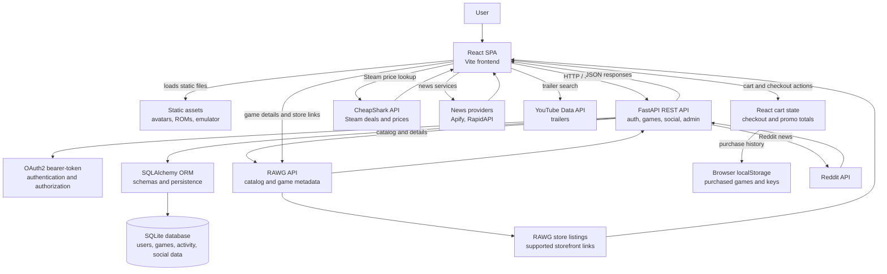

# GameBoxd System Architecture

## 2.1 Architectural Pattern

GameBoxd uses a client-server architecture with a modular monolithic backend. The frontend is a React single-page application bundled and served by Vite. It communicates with a FastAPI backend over HTTP using JSON REST endpoints and bearer-token authentication.

The backend contains the application's authentication, game-library, social, notification, administration, and integration logic in one deployable Python service. It uses SQLAlchemy to persist application data and calls external gaming-data and news providers when catalog, game-detail, or news data is required. Static ROM files and emulator assets are served from the frontend's `public` directory.

This structure keeps the application straightforward to develop and deploy while preserving clear boundaries between presentation, business logic, persistence, external integrations, and static media.

## 2.2 System Layers

- **Presentation Layer (Frontend):** A React/Vite single-page application provides authentication screens, the dashboard, game catalog, game details, library and collection views, profiles, social activity, news, administration screens, store purchase controls, cart, checkout, and the emulator interface. Store controls allow an authenticated user to add a game to the cart or start a buy-now flow. The cart supports quantity changes, remove, save-for-later, promo-code discounts, estimated tax, order totals, and purchase confirmation. Components in `src/components` render the UI, while `src/services` handles browser-side API and external-data requests. The frontend stores the returned access token and sends it as a bearer token for protected backend requests.
- **Application Layer (Backend):** FastAPI exposes REST endpoints for signup, login, games, reviews, profiles, follows, feeds, comments, reactions, notifications, administration, ROM management, and Reddit news. Authentication and authorization are handled with OAuth2-compatible bearer tokens. The backend validates request data with Pydantic schemas, applies game and social business rules, serializes responses, and delegates persistence to SQLAlchemy. Integration modules call RAWG and Reddit, while frontend services call selected news providers directly; environment variables supply credentials and configuration. The current store checkout is frontend-only: the backend does not process payments, create orders, or issue production keys.
- **Store and Integration Layer:** RAWG supplies game records, platform information, and links to supported online stores. `src/services/cheapShark.js` resolves Steam app IDs and retrieves the best matching Steam deal through CheapShark, with an in-memory price cache. The frontend normalizes the result into sale price, normal price, sale status, and store identifiers for the Online Store panel and cart. The current checkout creates simulated GameBoxd activation keys and stores purchased-game history in browser `localStorage`; external store links remain the source of real purchasing when applicable.
- **Data Layer:** SQLAlchemy models persist users, game entries, activities, follows, notifications, comments, and reactions. By default, the application uses a local SQLite database at `gameboxd.db`, configurable through `DATABASE_URL`. User avatars are stored under `public/avatars`, and ROM files plus emulator assets are stored under `public/roms` and `public/emulator`. Catalog metadata, screenshots, trailers, and news are retrieved from external services and presented or cached according to the relevant service behavior.

## 2.3 Data Flow

The following flow describes a user adding a RAWG game to their GameBoxd library:

1. The user searches the catalog or opens a game detail page in the React frontend and selects an action such as adding the game to the library.
2. The frontend sends a `POST /games` request through `src/services/backendApi.js`, including the RAWG game identifier, collection status, optional rating, and optional review. The access token is included in the `Authorization: Bearer` header.
3. FastAPI receives the request, validates the payload, authenticates the user, and opens a database session through the dependency in `backend/database.py`.
4. The backend uses the RAWG integration when game metadata is needed, checks the user's existing library entry, applies collection rules, and creates or updates the appropriate `GameEntry` record.
5. The backend records related activity and social notification data when the operation produces a visible user event, commits the transaction through SQLAlchemy, and serializes the saved entity into a JSON response.
6. The frontend consumes the response, updates the local React state, and re-renders the library, collection, activity feed, or profile view without a full page reload.

The following flow describes the current store checkout capability:

1. The user opens a RAWG game detail page. RAWG store metadata is used to identify supported storefront links and a Steam app ID when available.
2. The frontend requests the best matching Steam deal from CheapShark, normalizes the sale and regular prices, and caches the result in memory for the current browser session.
3. The authenticated user selects **Add to cart** or **Buy now**. The frontend stores the selected title, cover, platform, edition, and price in React cart state.
4. The user can adjust quantity, save an item for later, apply a supported promo code, and review the subtotal, discount, estimated tax, and calculated total.
5. Checkout runs through review, processing, and success states. The current implementation generates a simulated GameBoxd activation key and order identifier rather than calling a payment processor or fulfillment service.
6. Purchased-game history is written to browser `localStorage` and the cart is cleared. No order, payment, or key record is currently written to the FastAPI database.

## 2.4 Architecture Diagram

### Main Repository Boundaries

| Area | Responsibility |
| --- | --- |
| `src/` | React presentation, client state, API clients, catalog/news integrations |
| `backend/main.py` | FastAPI application, routes, request handling, orchestration |
| `backend/auth.py` | Password hashing and token-related authentication helpers |
| `backend/schemas.py` | Request and response validation models |
| `backend/models.py` | SQLAlchemy database entities and relationships |
| `backend/database.py` | Database engine, session factory, and request-scoped sessions |
| `backend/rawg.py` | Backend RAWG metadata integration |
| `public/` | Browser-served avatars, ROM files, emulator files, and other static assets |
| `vite.config.js` | Frontend development server and RapidAPI proxy configuration |

## 3. TECHNOLOGY STACK

| Component | Technology/Tool Chosen | Justification / Reason for Selection |
| --- | --- | --- |
| Frontend | React 19, Vite, JavaScript, HTML/CSS, Lucide React | React supports a responsive single-page interface built from reusable components. Vite provides a fast development server and optimized production build, while CSS controls the application's custom visual design. Lucide React supplies consistent interface icons. |
| Backend | Python, FastAPI, Uvicorn, Pydantic, SQLAlchemy | FastAPI provides lightweight REST endpoints, automatic request validation, and clear API organization. Python supports rapid development of authentication, game-library, social, administration, and integration logic. Uvicorn runs the asynchronous web server, Pydantic validates API data, and SQLAlchemy provides database access through Python models. |
| Database | SQLite with SQLAlchemy ORM | SQLite is suitable for the current local and small-scale deployment because it requires no separate database server and is simple to configure. SQLAlchemy separates application logic from database queries and allows the database to be changed later through `DATABASE_URL` if the system grows. |
| Hosting/Cloud | Localhost development using Vite and FastAPI/Uvicorn; deployable to a Python-compatible cloud host | The current project runs the frontend and backend locally for straightforward development and testing. The separation between the Vite client and FastAPI service allows them to be deployed independently to platforms such as Render, Railway, Fly.io, or a virtual server when production hosting is required. |
| Version Control | Git and GitHub-compatible repository workflow | Git provides change history, branching, and rollback for source code and documentation. A GitHub-compatible workflow supports collaboration, issue tracking, code review, and remote backup. |

## 4. KEY API INTEGRATIONS

GameBoxd connects to external gaming-data, pricing, media, and news services. The project currently has no physical product fulfillment, SMS provider, email provider, or production payment gateway. Store checkout and digital-key fulfillment are represented in the application, with transactions recorded for GameBoxd administration.

### 4.1 Payment Gateway

- **Provider:** No production payment gateway currently integrated. The checkout interface supports simulated Credit Card, PayPal, and GameBoxd Wallet payment methods.
- **Features Used:** Payment-method selection and validation states, wallet-balance deduction, promo-code discounts, estimated tax, checkout totals, order identifiers, and completed transaction recording.
- **Integration Method:** React state and browser interactions for the current payment simulation; `POST /transactions` REST API call to FastAPI records the completed transaction in SQLite through SQLAlchemy. A real deployment would replace the simulated payment step with a PCI-compliant gateway such as Stripe or PayPal REST APIs and server-side webhooks.

### 4.2 Logistics & Shipping

- **Provider:** No physical logistics or shipping provider. GameBoxd handles digital game-key delivery within the application.
- **Features Used:** Digital-key purchase records, simulated activation-key generation, order IDs, platform labels such as Steam Key or GOG DRM-Free, purchased-game library entries, and browser persistence for the user's purchase history.
- **Integration Method:** The frontend generates simulated keys after checkout, sends transaction metadata to the FastAPI `/transactions` endpoint, and stores purchased-game and transaction data in `localStorage` for the current browser experience. No physical shipping, tracking, warehouse, or production key-fulfillment integration is currently present.

### 4.3 Notifications (SMS/Email)

- **Provider:** No SMS or email provider is currently integrated. GameBoxd uses FastAPI notification endpoints backed by SQLite for in-app notifications.
- **Features Used:** Follow notifications, followed-user activity notifications, unread notification counts, notification lists, read-all behavior, and periodic frontend refresh. SMS, email, OTP, and email order-confirmation features are not currently implemented.
- **Integration Method:** Authenticated REST requests through `src/services/backendApi.js`, including `GET /me/notifications/followed-posts`, `GET /me/notifications/followed-posts/unread-count`, and `POST /me/notifications/followed-posts/read-all`. The frontend polls for updates approximately every 30 seconds and displays notifications in the React interface.

### 4.4 Game Catalog and Store Data

- **Provider:** RAWG Video Games Database API and CheapShark API.
- **Features Used:** Game catalog search, metadata, platforms, genres, screenshots, reviews, supported storefront links, Steam app ID discovery, price lookup, sale detection, and best-deal selection.
- **Integration Method:** Browser-side HTTPS `fetch` requests using the service modules in `src/services/rawgCatalog.js`, `src/services/rawgGameDetails.js`, and `src/services/cheapShark.js`. RAWG supplies the game and store metadata; CheapShark supplies Steam deal pricing, which is normalized and cached in memory by RAWG game ID.

### 4.5 News and Media Services

- **Provider:** Reddit API through the FastAPI backend, plus frontend news fallbacks and YouTube Data API v3 for trailers.
- **Features Used:** Gaming-news feed, article normalization, Reddit caching, fallback news links, trailer search, and embedded gameplay or promotional videos.
- **Integration Method:** Reddit requests are handled by FastAPI at `/news/reddit` with an in-memory cache and optional OAuth credentials. The frontend uses `src/services/gamingNews.js` for news-source handling and `src/services/videoFetcher.js` for HTTPS YouTube Data API requests. YouTube credentials are supplied through `VITE_YOUTUBE_API_KEY`.

## SUMMARY

GameBoxd is a React and Vite single-page gaming platform connected to a Python FastAPI backend. The backend provides authentication, game-library management, social features, notifications, administration, ROM management, and transaction recording, while SQLAlchemy and SQLite provide the persistence layer. The frontend also connects to RAWG for game data and store listings, CheapShark for Steam pricing, Reddit for gaming news, and YouTube for trailers.

The system supports game discovery, personal libraries, reviews, social activity, digital-store browsing, cart management, simulated checkout, and digital-key purchase records. Store transactions are recorded through the backend, but payment processing, physical shipping, production key fulfillment, SMS, and email notifications are not currently integrated. This architecture keeps the project simple to run locally while leaving clear integration points for production payment, delivery, hosting, and notification services in the future.